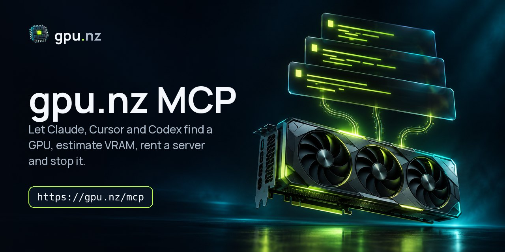

<div align="center">



# gpu.nz MCP server

**Let Claude, Cursor, Codex and other AI agents rent cloud GPUs:** search RTX 4090, A100, H100 and B200 servers with live prices, work out how much VRAM a model needs, launch ComfyUI, Ollama, vLLM or Jupyter, read the logs and stop the server when the job is done. Billed by the minute.

[](https://gpu.nz/en/docs/mcp)
[](https://gpu.nz/en/docs/mcp)
[](LICENSE)

[Docs](https://gpu.nz/en/docs/mcp) · [VRAM calculator](https://gpu.nz/en/tools/vram) · [REST API](https://gpu.nz/en/docs/api) · [CLI](https://github.com/gpunz/gpunz-cli) · [Русский](#по-русски)

</div>

---

## Connect

The server is hosted at **`https://gpu.nz/mcp`** — nothing to install. Browsing GPUs, prices and VRAM estimates works without a key; renting and managing servers needs an API key from [gpu.nz/console/keys](https://gpu.nz/en/console/keys).

**Claude Code**

```bash
claude mcp add --transport http gpunz https://gpu.nz/mcp \
  --header "Authorization: Bearer gpz_…"
```

**Cursor** — `~/.cursor/mcp.json`

```json
{
  "mcpServers": {
    "gpunz": {
      "url": "https://gpu.nz/mcp",
      "headers": { "Authorization": "Bearer gpz_…" }
    }
  }
}
```

**VS Code** — `.vscode/mcp.json` (asks for the key once and keeps it in secret storage)

```json
{
  "servers": {
    "gpunz": {
      "type": "http",
      "url": "https://gpu.nz/mcp",
      "headers": { "Authorization": "Bearer ${input:gpunz-key}" }
    }
  },
  "inputs": [{ "type": "promptString", "id": "gpunz-key", "description": "gpu.nz API key", "password": true }]
}
```

**Codex CLI**

```bash
export GPUNZ_API_KEY="gpz_…"
codex mcp add gpunz --url https://gpu.nz/mcp --bearer-token-env-var GPUNZ_API_KEY
```

**Claude Desktop** — `claude_desktop_config.json`, through [mcp-remote](https://www.npmjs.com/package/mcp-remote)

```json
{
  "mcpServers": {
    "gpunz": {
      "command": "npx",
      "args": ["-y", "mcp-remote", "https://gpu.nz/mcp", "--header", "Authorization:${GPUNZ_AUTH}"],
      "env": { "GPUNZ_AUTH": "Bearer gpz_…" }
    }
  }
}
```

On claude.ai you can add `https://gpu.nz/mcp` under **Connectors** without a key: search and estimates work.

### Local stdio bridge

For clients that only start local servers, this repository is a small stdio bridge to the hosted server:

```bash
# Docker
docker run -i --rm -e GPUNZ_API_KEY="gpz_…" ghcr.io/gpunz/gpunz-mcp

# Node.js 18+, straight from GitHub
GPUNZ_API_KEY="gpz_…" npx -y github:gpunz/gpunz-mcp
```

| Variable | |
|---|---|
| `GPUNZ_API_KEY` | API key (`gpz_…`). Optional: without it only the browsing tools work |
| `GPUNZ_MCP_URL` | Endpoint override, default `https://gpu.nz/mcp` |

## Tools

| Tool | What it does | Key scope |
|---|---|---|
| `list_gpu_models` | GPU models in stock: memory, class, cheapest price per hour | — |
| `search_offers` | Servers with live prices; filter by GPU, count, VRAM, price, country, reliability | — |
| `get_offer` | One server and its current price | — |
| `list_templates` | Ready environments: ComfyUI, Forge, Ollama + Open WebUI, vLLM, Jupyter, Kohya, FluxGym, Unsloth, your own Docker image | — |
| `estimate_vram` | VRAM a model needs (Qwen, DeepSeek, Llama, Gemma, GPT-OSS, FLUX, Wan…) at a quantisation and context, and the cheapest GPUs that fit | — |
| `topup_link` | A link to top up the balance in the browser | — |
| `get_account` | Account, balance, hourly spend and runway | `user:read`, `billing:read` |
| `list_instances` · `get_instance` | Your servers: status, SSH command, app URLs, cost so far | `instances:read` |
| `get_instance_logs` | The last log lines: boot, app start-up, errors | `instances:read` |
| `create_instance` | Rents a server with a template; billing starts at once | `instances:write` |
| `stop_instance` · `start_instance` | Stop (only the disk is billed) and start again | `instances:write` |
| `destroy_instance` | Destroys a server and its disk | `instances:write` |
| `list_ssh_keys` · `add_ssh_key` | SSH keys installed on new servers | `user:read` / `user:write` |

## Try asking

- *How much VRAM does Qwen3.8 27B need with a 32k context, and where is it cheapest?*
- *Find the cheapest RTX 4090 with reliability above 0.98 and start ComfyUI on it with an 80 GB disk.*
- *Run GPT-OSS 120B on one H100 and give me the chat link when the server is ready.*
- *Show my servers and what they cost per hour; stop the ones I haven't touched since yesterday.*

## Money and safety

- The agent cannot spend more than your balance: top-ups happen in the browser only.
- `create_instance`, `start_instance` and `destroy_instance` are annotated as consequential, so clients ask you before running them.
- The root password stays out of tool output unless asked for explicitly; your SSH keys are installed on every server.
- The tools call the gpu.nz REST API with your key: its scopes, the rate limit (120 requests a minute per key) and the account's audit log apply.

## По-русски

MCP-сервер gpu.nz подключает аренду видеокарт к ИИ-агентам: Claude, Cursor, Codex и другим. Агент сам найдёт подходящую видеокарту, посчитает видеопамять для модели, арендует сервер с ComfyUI, Ollama или vLLM, прочитает логи и остановит сервер. Адрес: `https://gpu.nz/mcp`, оплата поминутная, в рублях через СБП или криптой. Документация: [gpu.nz/docs/mcp](https://gpu.nz/docs/mcp).

## License

MIT. gpu.nz is a GPU cloud billed by the minute; the hosted server and the API are run by gpu.nz.
